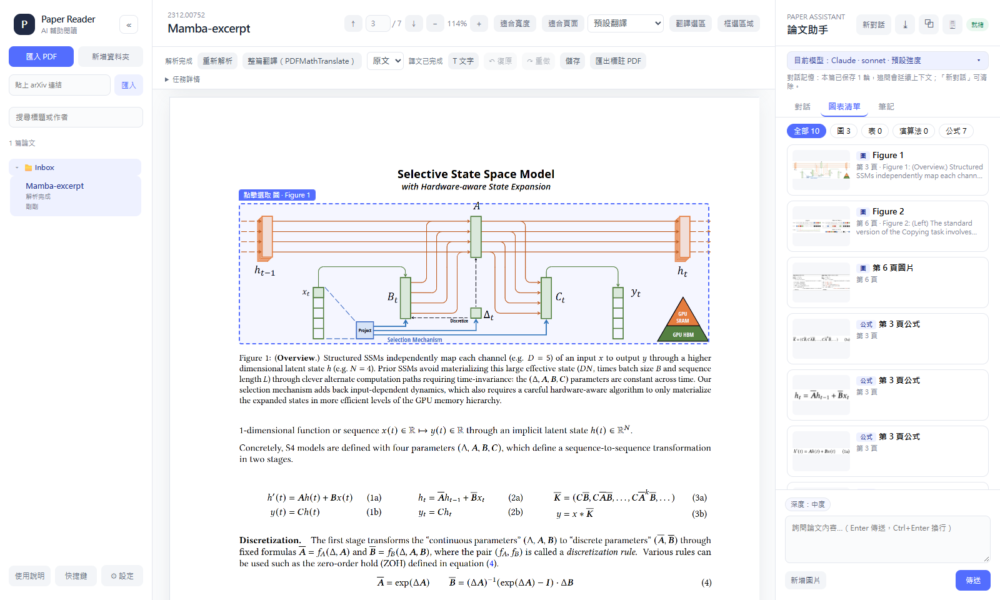
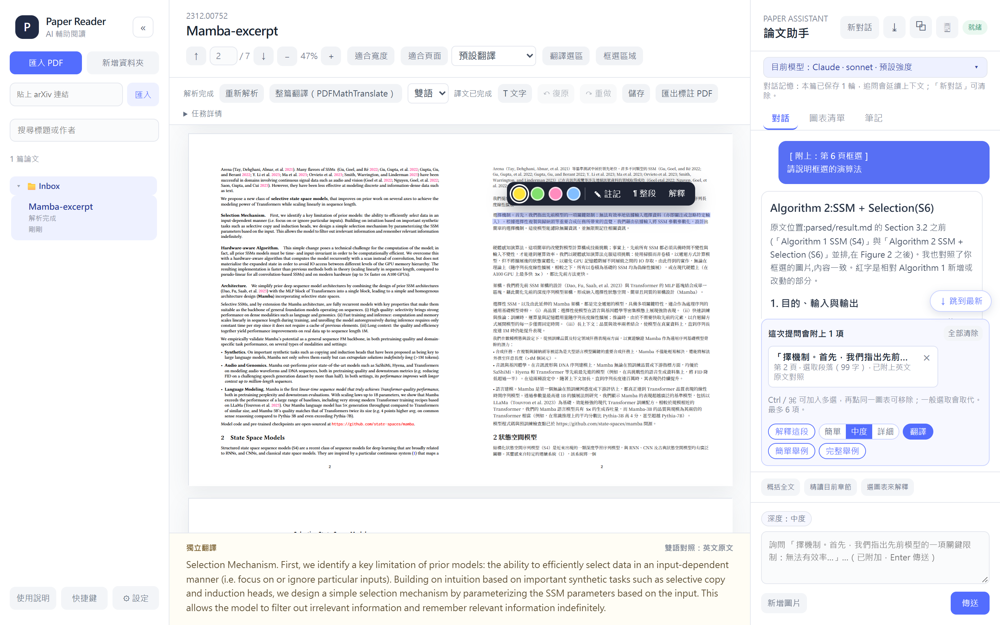

# Paper Reader（本機版）

**在自己電腦上讀論文的 AI 閱讀器。** 點一下論文裡的圖表或演算法就能請 AI 逐步解釋；中英雙語左右對照；像 Adobe 一樣畫螢光筆、加文字、寫筆記，並真正存進 PDF。不需要任何付費 API key：AI 直接使用你已登入的 **Codex CLI** 或 **Claude Code** 訂閱，PDF 解析用本機 **MinerU**，選區翻譯用本機 **Ollama**。

> 介面為台灣繁體中文，以 Windows + Chrome／Edge 為主要環境。改編自 [wenhuahuo/PaperReader](https://github.com/wenhuahuo/PaperReader)（MIT）。


## 主要功能

### 1. 點圖表、演算法、公式，直接問 AI

滑鼠移到論文上的圖、表、演算法或公式會出現虛線框，點一下就附加到右側助手，也可以從「圖表清單」挑選。附給 AI 的不是模糊截圖，而是 MinerU 解析出的**論文原文**（演算法全文、LaTeX 公式、表格內容）加上原圖。按住 `Ctrl` 可以多選，一起「比較這些」。



### 2. 演算法逐步解釋（可選簡單／中度／詳細）

框選或點選演算法，按「逐步解釋演算法」，AI 會先在全文找到原文，再逐行說明、列出符號表，並代入小數字實際走一遍。解釋深度可切換 **簡單／中度／詳細**，舉例可選 **簡單舉例／完整舉例**。


**實際輸出節錄**（Mamba 論文 Algorithm 2，Claude Sonnet）：

> **Algorithm 2：SSM + Selection（S6）**
> 原文位於 Section 3.2「Improving SSMs with Selection」……
>
> | 行 | 原文 | 做什麼、為什麼 |
> |---|---|---|
> | 2 | `B : (B,L,N) ← s_B(x)` | B 由輸入投影得到，決定「當前輸入有多少寫進狀態」。 |
> | 4 | `Δ : (B,L,D) ← τ_Δ(Parameter + s_Δ(x))` | Δ 是步長，決定要「重置、忽略」還是「保留」狀態；softplus 保證 Δ > 0。 |
> | 6 | `y ← SSM(Ā,B̄,C)(x)` | 因為 Ā、B̄ 每個時間步都不同，不能再用卷積，只能用遞迴（scan）。 |
>
> 接著是符號表（B、L、D、N 的意義與維度）、小數值例子，以及與 Algorithm 1、Figure 2 的對照。

### 3. 中英雙語左右對照

匯入時可勾選「自動整篇翻譯」（PDFMathTranslate），之後在原文、中文、雙語之間切換。雙語版左右**對稱**：選右邊的中文段落，會自動找出左邊對應的英文原文（反之亦然），按「翻譯」立即顯示，不需再呼叫模型；右邊的中文圖表一樣可以點選。



### 4. 螢光筆、文字、筆記，真正存進 PDF

- 選取文字後浮出工具列：四色螢光筆、註記；也可以「左鍵拖曳時按右鍵」、滑鼠側鍵或 `H` 直接畫黃色重點。
- 「T 文字」在頁面任何位置加文字，可選顏色、字型、大小、粗斜體與便利貼底色。
- `Ctrl+Z` 復原、`Ctrl+Y` 重做；`Ctrl+S` 把所有螢光筆、註記、文字寫成**標準 PDF 標註**（嵌入字型，Adobe Acrobat、Chrome、Edge 都看得到），存到匯出資料夾並保留上一版備份。
- 「筆記」分頁集中列出所有重點，可匯出成 Markdown。


### 5. 其他

- **對話有記憶**：每篇論文的對話存在本機，重開後可以接著追問。
- **選段落、選名詞**：**三擊文字直接選取整段**（依 MinerU 解析的段落邊界；或按選取工具列的「¶ 整段」擴大），可「解釋這段／翻譯」；只選幾個字會變成「解釋這個名詞」。
- **隨時切換模型**：助手頂部顯示目前模型，點一下切換 Codex／Claude、模型與思考強度。
- **雙螢幕**：助手可以開成獨立視窗（可最大化、拖到另一個螢幕），也可以收起左欄、把助手拉出浮動。
- **閱讀器**：適合寬度／頁面、`Ctrl+滾輪` 縮放、`Ctrl+F` 全文搜尋、方向鍵翻頁、高解析度渲染；按 `?` 顯示所有快捷鍵。
- **App 模式**：以 Chrome／Edge App 視窗開啟（沒有網址列），可建立桌面捷徑。

## 安裝

需要 Windows、[Node.js](https://nodejs.org/) 24 以上，以及 Chrome 或 Edge。

1. 下載本專案：右上角 **Code → Download ZIP** 後解壓縮，或用 `git clone`。
2. **雙擊資料夾裡的 `Paper Reader.exe`**（藍底白色「P」圖示）。第一次會詢問是否安裝，按「是」後會開啟安裝視窗，裝好就自動開啟。
3. 之後每次使用：雙擊 `Paper Reader.exe` 或桌面上的「Paper Reader」捷徑。

> 下載 ZIP 的 exe 沒有數位簽章，Windows 可能跳出「Windows 已保護您的電腦」：按「其他資訊 → 仍要執行」。不放心的話可以用 `scripts\build-launcher.ps1` 從 `launcher\PaperReader.cs` 自行編譯（只用 Windows 內建的 C# 編譯器）。

安裝內容（`setup.ps1 -MinerU -Translate`，也可以手動執行）：安裝套件與建置、把 MinerU 安裝到 `tools\mineru`（含模型約 1.5 GB）、把整篇翻譯用的 `pdf2zh_next` 安裝到 `tools\pdf2zh`、檢查 AI 工具，並在桌面建立「Paper Reader」捷徑。程式在 http://127.0.0.1:3080 執行，以沒有網址列的 App 視窗開啟。

### 需要的外部工具

| 用途 | 工具 | 說明 |
|---|---|---|
| AI 助手（預設） | [Codex CLI](https://github.com/openai/codex) | `npm install -g @openai/codex`，再 `codex login`（使用 ChatGPT 訂閱） |
| AI 助手（可選） | [Claude Code](https://docs.anthropic.com/claude-code) | 安裝後登入 Claude 訂閱帳號 |
| PDF 解析 | [MinerU](https://github.com/opendatalab/MinerU) | `setup.ps1 -MinerU` 自動安裝；也可用環境變數 `MINERU_KIT`／`MINERU_HOME` 或在「設定」頁指定 |
| 選區翻譯（可選） | [Ollama](https://ollama.com/) | `ollama pull hf.co/tencent/Hy-MT2-7B-GGUF:Q4_K_M`；也可改用 Codex／Claude 翻譯 |
| 整篇翻譯（可選） | [PDFMathTranslate-next](https://github.com/PDFMathTranslate/PDFMathTranslate-next) | `setup.ps1 -Translate` 自動安裝；翻譯服務沿用 Codex／Claude 訂閱或本機 Ollama，橋接腳本在 `pdf-translate/` |

沒裝的工具只會讓對應功能無法使用；閱讀、螢光筆、筆記等功能不受影響。

## 使用小提示

- **建議匯入英文原文**：解析與 AI 回答品質最好；要看中文再用「整篇翻譯」。已翻譯的雙語 PDF 也能匯入，系統會自動辨識並停用重複翻譯。
- **解析只做一次**：結果存在本機，之後開啟直接沿用；需要時按「重新解析」。
- **資料都在本機**：論文、解析、對話、螢光筆與設定都在 `.runtime/`。只有你提問時的內容會送到 Codex／Claude。

## 快捷鍵

| 按鍵 | 功能 |
|---|---|
| `H`、左鍵拖曳＋右鍵、滑鼠側鍵 | 用預設顏色畫重點 |
| `T` | 加入文字 |
| `Ctrl+Z`／`Ctrl+Y` | 復原／重做 |
| `Ctrl+S` | 把標註存進 PDF |
| 三擊文字 | 選取整段 |
| `Ctrl`＋點圖表 | 多選附件 |
| `Ctrl+F` | 搜尋 PDF 全文 |
| `←` `→`、`PageUp` `PageDown` | 翻頁 |
| `Ctrl`＋滾輪 | 縮放 |
| `?` | 顯示快捷鍵表 |

## 開發

```powershell
npm.cmd run check   # 單元測試
npm.cmd run build   # 建置前端到 dist/
npm.cmd start       # 啟動服務（PORT 預設 3080）
```

## 授權與致謝

- 本專案以 MIT 授權釋出（`pdf-translate/` 因使用 AGPL-3.0 的 pdf2zh_next，該資料夾為 AGPL-3.0），改編自 [wenhuahuo/PaperReader](https://github.com/wenhuahuo/PaperReader)（MIT）。
- 截圖中的論文為 Gu & Dao, *Mamba: Linear-Time Sequence Modeling with Selective State Spaces*（[arXiv:2312.00752](https://arxiv.org/abs/2312.00752)，CC BY 4.0），節錄前 7 頁作為示範，中文譯文由本工具產生。
- 使用 [pdf.js](https://github.com/mozilla/pdf.js)、[pdf-lib](https://github.com/Hopding/pdf-lib)、[KaTeX](https://katex.org/)、[MinerU](https://github.com/opendatalab/MinerU) 等開源專案。
